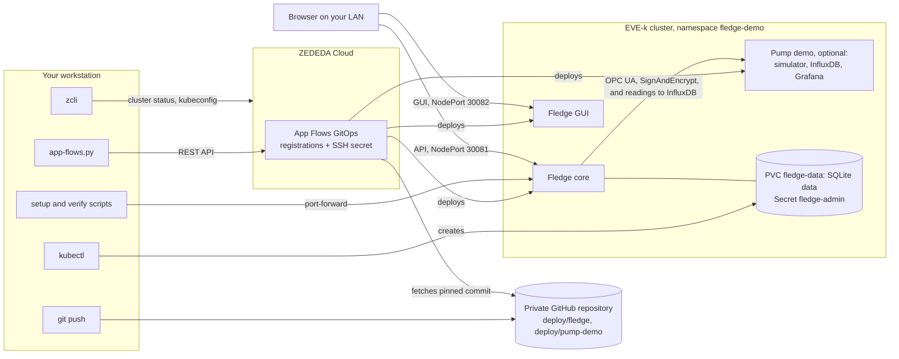

# Fledge on ZEDEDA

This repository shows how to run [Fledge](https://www.lfedge.org/projects/fledge/),
the LF Edge project for collecting industrial sensor data at the edge, on a
ZEDEDA-managed edge node. It targets EVE-k, the Kubernetes variant of the EVE
edge operating system, and deploys Fledge from Git with ZEDEDA App Flows.

The demo reads a simulated sinusoid signal once per second and keeps
configuration and readings across pod restarts. It serves an authenticated API
and the upstream Fledge GUI on your LAN. The optional [pump demo](docs/pump-demo.md)
adds three simulated pumps that Fledge reads over a secure OPC UA connection,
with faults you can inject while it runs. It stores the pump readings in InfluxDB,
shows them on a Grafana dashboard, and keeps readings through an InfluxDB outage.
Its optional [inference stage](docs/pump-inference.md) scores each pump with an
anomaly model that ZEDEDA Edge Inference Services serves on the node's CPU, and
shows the score next to the injected fault.

This guide takes you from cluster access to live readings in the GUI.

## How it works



The demo runs two workloads in the `fledge-demo` namespace. Fledge core reads
the sinusoid source once per second, stores configuration and readings in SQLite
on a persistent volume claim (PVC), and serves the API. The Fledge GUI is a web
app: your browser loads it from NodePort 30082 and then calls the API directly on
NodePort 30081. The optional pump demo is a third workload with its own App Flows
registration; the [pump demo](docs/pump-demo.md) covers it.

The steps below put it in place in three parts:

- **You create the data resources** with `kubectl` (step 2): the namespace, the
  PVC and the admin Secret. App Flows doesn't manage them, so they stay when you
  remove the workload.
- **App Flows deploys the workload** (steps 3 and 4). You register your private
  repository with App Flows. The registration, listed in the ZEDEDA console as
  a GitOps repository, names the repository, the `deploy/fledge` path and a
  pinned commit. App Flows installs the Helm chart in `deploy/fledge/chart` from
  that commit, with the values in its Fleet configuration,
  [fleet.yaml](deploy/fledge/fleet.yaml). To deploy a change, you update the
  registration to a new commit. Deleting the registration removes the workload.
- **You configure Fledge** through its API with the setup script (step 5). It
  replaces the default admin password and adds the sinusoid source. Until then, a
  new core pod stays unready; this is expected. Fledge keeps this configuration
  on the PVC, so you run the script once per install, not after pod restarts.

For the design choices behind this, see [architecture](docs/architecture.md).

## Before you start

You need:

- A single-node AMD64 EVE-k cluster enrolled in ZEDEDA, with a Ready node and
  App Flows enabled. To create one, see ZEDEDA's
  [cluster guide](https://help.zededa.com/hc/en-us/articles/39344203451547).
- A default storage class for a 2 GiB writable volume. The k3s `local-path`
  class works; it stores data on the node's disk and does not protect against
  node or disk loss.
- Capacity for the workload: Fledge core requests 250m CPU and 256 MiB memory
  (limits 1 CPU and 1 GiB), and the GUI requests 10m CPU and 16 MiB (limits 100m
  and 64 MiB). The optional pump simulator requests 50m CPU and 96 MiB (limits
  500m and 256 MiB); with InfluxDB and Grafana, the whole pump demo needs more,
  as listed in the [pump demo](docs/pump-demo.md#before-you-start).
- Permission to create a namespace, PVC and Secret. The cluster must allow the
  Fledge container to run as root.
- A ZEDEDA API token with access to the cluster and its GitOps resources
  (**User profile → Session Information**), and a private GitHub repository to
  which you can push and add a read-only deploy key.
- Docker, Git, Python 3.10 or newer, `jq`, `openssl`, `ssh-keygen`, and
  `kubectl` within one minor version of your cluster.
- Network access: your workstation reaches GitHub and ZEDEDA over HTTPS, App
  Flows reaches GitHub over SSH, and the cluster reaches Docker Hub.

The pinned published images are used by default: `matthiasl381/fledge` (core with
the sinusoid 3.1.0 and OPC UA `s2opcua` 3.1.0 plugins and this repository's
`influxdb` north plugin), `matthiasl381/fledge-gui` and, for the pump demo,
`matthiasl381/pump-simulator` with the upstream `influxdb` and `grafana/grafana`
images, pinned by digest. To build your own, see
[Build the images](docs/building-image.md).

> [!WARNING]
> The supplied [Fleet configuration](deploy/fledge/fleet.yaml) exposes the GUI on
> NodePort `30082` and the API on `30081` over plain HTTP. The pump demo's
> Grafana uses NodePort `30083` in the same way. NodePort does not
> restrict access to your LAN, and credentials and tokens are not encrypted.
> Use a restricted network, or switch to private access first as described in
> [Browser and LAN access](docs/browser-and-lan.md#private-access-only).

## 1. Connect to the cluster with zcli

Copy [.env.example](.env.example) to `.env` and set two values:

- `ZEDEDA_CLUSTER`: the cluster's name as shown in the ZEDEDA console under
  **Edge Kubernetes → Clusters**. Use the name, not the UUID, and not the name
  of its node, which can differ.
- `FLEDGE_GITOPS_REPOSITORY_URL`: your private repository's SSH URL, in the form
  `ssh://git@github.com/OWNER/REPO.git`.

`.env` holds no secrets and is ignored by Git. Load it in each terminal you use:

```sh
cp .env.example .env    # then edit ZEDEDA_CLUSTER and FLEDGE_GITOPS_REPOSITORY_URL
set -a; . ./.env; set +a
```

zcli is ZEDEDA's command-line client, published as a container image. Run it
with a private configuration directory on your host:

```sh
mkdir -m 700 -p ~/.config/zededa ~/.kube
alias zcli='docker run --rm -it --user "$(id -u):$(id -g)" -v "$HOME/.config/zededa:/home/zcli/.config/zededa" zededa/zcli@sha256:84b959543347b204bae1e7108934fa042e24843f040e6fbe47e6f75929a79e74 zcli'
zcli configure
zcli login
```

`zcli configure` asks for the server (for example `zedcontrol.zededa.net`); answer
`y` to **Login with token?** and paste your API token. The token is shown as you
paste it. The login also serves `scripts/app-flows.py` in step 3. See
ZEDEDA's [CLI overview](https://help.zededa.com/hc/en-us/articles/6374715356315).

Inspect your cluster and save its kubeconfig:

```sh
zcli --format=json edge-kubernetes-cluster status "$ZEDEDA_CLUSTER" | jq '.list[] | {name, runState}'
(umask 077; zcli --format=json edge-kubernetes-cluster generate-kubeconfig "$ZEDEDA_CLUSTER" \
  | jq -r .config > ~/.kube/"$ZEDEDA_CLUSTER".yaml)
export KUBECONFIG=~/.kube/"$ZEDEDA_CLUSTER".yaml
kubectl get nodes
kubectl get storageclasses
```

zcli can print an error and still exit 0, so read its output: the status should
show `RUN_STATE_ONLINE`. Confirm that the node is `Ready` and that one storage
class is marked `(default)`. Rerun the kubeconfig command to refresh access.

## 2. Create storage and the admin Secret

[deploy/prerequisites.yaml](deploy/prerequisites.yaml) defines the `fledge-demo`
namespace and the `fledge-data` PVC, which uses the default storage class. Check
for existing resources with these names, then apply it:

```sh
kubectl get -f deploy/prerequisites.yaml --ignore-not-found
kubectl apply -f deploy/prerequisites.yaml
```

If the first command lists resources, confirm that they belong to this demo
before you apply.

Create the admin Secret with a generated password. The fixed suffix satisfies
Fledge's password policy. The Secret is the only copy of the password:

```sh
kubectl -n fledge-demo create secret generic fledge-admin \
  --from-literal=username=admin \
  --from-literal=password="$(openssl rand -base64 18 | tr -d '/+=')aA1!"
```

If you are reinstalling over retained data, keep the existing Secret: a new
password does not change the account stored in Fledge.

## 3. Give App Flows access to your repository

App Flows deploys from a Git repository that you control, so push a copy of this
repository to the private repository you set in `.env`. Create it on GitHub
without a README or license, so that it is empty, then push:

```sh
git remote add deploy "$FLEDGE_GITOPS_REPOSITORY_URL"
git push deploy HEAD:main
```

The push uses your own GitHub access: the `ssh://` URL needs an SSH key in your
GitHub account. To push over HTTPS instead, add the remote with the repository's
HTTPS URL. Later changes, such as edits to `fleet.yaml`, go to the same remote.

App Flows reads only `deploy/fledge`, at the commit you register in step 4. It
connects with a read-only deploy key, which you create now and store in ZEDEDA.

Create a deploy key. If you already prepared a key for this demo, reuse it; do
not overwrite it or register it twice.

```sh
ssh-keygen -t ed25519 -N '' -C fledge-demo-gitops -f ~/.ssh/fledge-demo-gitops
cat ~/.ssh/fledge-demo-gitops.pub
```

Register the public key with your repository: on GitHub, open the repository's
**Settings → Deploy keys → Add deploy key**, paste the output of `cat`, and leave
**Allow write access** cleared.

Store the key pair in ZEDEDA as the SSH secret App Flows uses:

```sh
python3 scripts/app-flows.py secret-create \
  --private-key ~/.ssh/fledge-demo-gitops --public-key ~/.ssh/fledge-demo-gitops.pub
```

zcli has no GitOps commands, so `scripts/app-flows.py` calls the documented App
Flows REST API with your zcli login. It reads the cluster, repository URL,
registration name, secret name and path from `.env`; environment variables
override it. It looks up the cluster's project, then prints each request, for
example
`POST /api/v1/cluster/instances/kubernetes/secrets`. The API reference is at
`https://<your-zedcontrol-host>/api/v1/docs/` under **KubernetesSecrets** and
**KubernetesGitOps**; see ZEDEDA's
[REST API article](https://help.zededa.com/hc/en-us/articles/42792971664539).
If the secret already exists, the command reports it and leaves it unchanged.
The ZEDEDA Terraform provider (`zededa/zedcloud`) can also be used to create
the secret and registration.

## 4. Deploy Fledge

Register your repository at the commit you pushed. `apply` uses the repository
URL and path from `.env`, and the commit must already be on GitHub:

```sh
python3 scripts/app-flows.py apply --revision "$(git rev-parse HEAD)"
python3 scripts/app-flows.py status
kubectl -n fledge-demo get pods,pvc
```

`status` shows the registration and the platform's own status and conditions.
The same view is in the ZEDEDA console under **Edge Kubernetes → GitOps
Repositories** ([console guide](https://help.zededa.com/hc/en-us/articles/42795724131995)).
Wait until the core pod is `Running` and the PVC is `Bound`. The pod stays
unready until you initialize it in the next step. To deploy a later chart or
image change, push it and run `apply` with the new commit.

## 5. Initialize and configure Fledge

In a **second terminal** in the repository, forward the API from the pod to your
workstation. Forwarding works before the pod is ready:

```sh
set -a; . ./.env; set +a
export KUBECONFIG=~/.kube/"$ZEDEDA_CLUSTER".yaml
kubectl -n fledge-demo port-forward --address 127.0.0.1 deployment/fledge 8081:8081
```

Leave it running. Back in the first terminal, read the admin credentials from
the Secret, then initialize and configure Fledge:

```sh
export FLEDGE_ADMIN_USERNAME=admin
export FLEDGE_ADMIN_PASSWORD="$(kubectl -n fledge-demo get secret fledge-admin -o jsonpath='{.data.password}' | base64 -d)"
python3 scripts/setup-fledge.py initialize --api http://127.0.0.1:8081
python3 scripts/setup-fledge.py configure --api http://127.0.0.1:8081 --config demos/sinusoid.json
```

`initialize` replaces the default password and confirms that protected access
needs it; repeating it is safe. `configure` applies
[demos/sinusoid.json](demos/sinusoid.json): one sinusoid reading per second,
kept for 24 hours. Both scripts print each Fledge API call they make.

The pod becomes ready after `initialize`. Readiness confirms the core, storage
and authentication, not acquisition. Check for actual readings:

```sh
python3 scripts/verify-fledge.py --api http://127.0.0.1:8081 --snapshot /tmp/fledge-readings.json
```

The verifier waits up to 120 seconds for three new readings. It ends with
`PASS: authentication, source identity and three new acquired readings`. The
snapshot is used by the [persistence check](docs/operations.md#confirm-readings-survive-a-restart).

## 6. Open the GUI

Find the node's LAN address in the ZEDEDA console; it can differ from the
Kubernetes internal address. Open `http://<node-address>:30082`, then:

1. Choose **Setup Instance**. If the GUI can't reach its default API, it opens
   **Connection Setup** and shows **Failed to connect**.
2. Select `http`, enter the node address as **Host** and `30081` as **Port**, and
   click **Set the URL & Restart**.
3. Log in with `admin` and the password from the Secret. The dashboard's
   **Received** count increases as readings arrive.

For private access through port-forwarding, source editing and switching off LAN
exposure, see [Browser and LAN access](docs/browser-and-lan.md).

## Remove the demo

If you deployed the pump demo, [remove it](docs/pump-demo.md#remove-the-pump-demo)
first. Then delete the Fledge App Flows registration. The command shows the registration and asks
you to confirm. App Flows then removes the workload; the PVC and admin Secret
stay:

```sh
python3 scripts/app-flows.py delete
python3 scripts/app-flows.py status
kubectl -n fledge-demo get deployment,pod,service -l app.kubernetes.io/instance=fledge
kubectl -n fledge-demo get pvc fledge-data
kubectl -n fledge-demo get secret fledge-admin
```

When `status` reports `not found`, check again after two minutes (two default
reconciliation intervals). The workload should stay absent. To resume, run
`apply` with a compatible commit that uses the same PVC and Secret, wait for
readiness and restart the port-forward. To delete the data too, follow
[Delete the saved data](docs/operations.md#delete-the-saved-data).

After you delete the data and the admin Secret, delete the namespace if nothing
else uses it. Deleting a namespace also deletes everything that is still in it:

```sh
kubectl -n fledge-demo get all,pvc,secret
kubectl delete namespace fledge-demo
```

The SSH secret stays in ZEDEDA, because the API can't delete it. To revoke the
repository access, remove the deploy key from your GitHub repository. To deploy
again with a new key pair, set a new `FLEDGE_GITOPS_SECRET` name in `.env`.

## Next steps

- [Pump demo](docs/pump-demo.md): simulated pumps over secure OPC UA, fault
  injection, the pump data, InfluxDB and the Grafana dashboard, retention and
  recovery after an InfluxDB outage.
- [Pump inference](docs/pump-inference.md): an anomaly model served by ZEDEDA
  Edge Inference Services, scoring in Fledge, the score on the dashboard and
  behavior during an inference outage.
- [Operations](docs/operations.md): configuration changes, persistence and
  shutdown checks, image upgrades, custom names, data deletion and
  troubleshooting.
- [Browser and LAN access](docs/browser-and-lan.md): GUI details, private access
  and custom ports.
- [Build the images](docs/building-image.md): plugin selection, the pump
  simulator image and publishing.
- [Testing](docs/testing.md): unit and integration tests for changes to the
  chart, images and scripts.

## Status and limits

The demo is tested on a single-node AMD64 EVE-k cluster. Other cluster sizes
and architectures are untested. The HTTP LAN access is meant for a restricted
network; the demo has no TLS.

For the design, see [architecture](docs/architecture.md).

## License

Apache License 2.0; see [LICENSE](LICENSE) and [NOTICE](NOTICE).
