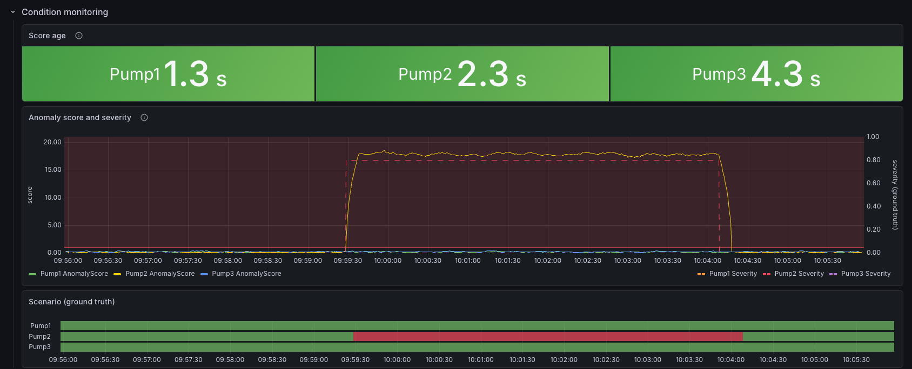
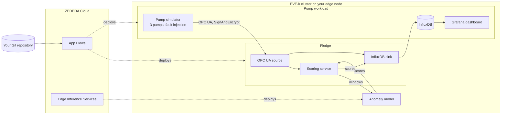

# Fledge on ZEDEDA

This repository shows condition monitoring for industrial pumps at the edge,
built with [Fledge](https://www.lfedge.org/projects/fledge/), the LF Edge project
for collecting industrial sensor data, on a [ZEDEDA](https://zededa.com/)-managed
edge node. It targets EVE-k, the Kubernetes variant of the [EVE edge operating system](https://lfedge.org/projects/eve/),
and deploys from Git with ZEDEDA App Flows.

Three simulated pumps serve their measurements over a secure OPC UA connection.
Fledge reads them, stores them in InfluxDB and shows them on a Grafana
dashboard. An anomaly model, served on the node's CPU by ZEDEDA Edge Inference
Services (EIS), scores each pump. You inject a fault, such as bearing wear, and
see its score rise next to the fault you set.

*Pump2 with an injected bearing-wear fault: its anomaly score (solid) follows the
injected severity (dashed) and the ground-truth scenario (red bar).*

Solid arrows show the data; dotted arrows show what deploys it.

## What ZEDEDA provides

- **Edge Kubernetes on EVE-k**: the cluster on the edge node, enrolled in
  ZEDEDA. You inspect it and get its kubeconfig with zcli, ZEDEDA's command-line
  client.
- **App Flows**: deploys Fledge and the pump workload (simulator, InfluxDB and
  Grafana) from your Git repository, each at a pinned commit. To change what
  runs, you push and point the deployment at the new commit.
- **Edge Inference Services (EIS)**: deploys the anomaly model with a model
  server on the node's CPU, after a second user approves the deployment.

## The three parts

You build the demo in three parts, each on top of the previous one. You can stop
after any of them.

| Part | What it adds | What you need in addition |
| --- | --- | --- |
| [1. Install Fledge](docs/1-install-fledge.md) | Fledge and its GUI, deployed with App Flows, with persistent storage and managed login. A sinusoid source checks that it works. | An AMD64 EVE-k cluster with App Flows, a ZEDEDA API token and a private GitHub repository |
| [2. Pump data pipeline](docs/2-pump-pipeline.md) | The pump simulator, InfluxDB and Grafana. Fledge reads the pumps over secure OPC UA and buffers readings through an InfluxDB outage. You inject faults. | A second 2 GiB volume |
| [3. Anomaly scoring](docs/3-anomaly-scoring.md) | An anomaly model deployed through EIS. Fledge scores every pump, and the dashboard shows the score next to the injected fault. | An EIS organization and a second EIS user to approve the deployment |

Each part lists its full prerequisites and resource requests. If you open a new
terminal between parts, restore its settings with
[Set up a terminal](docs/terminal-setup.md).

The demo serves the Fledge GUI, its API and Grafana on your LAN over plain HTTP,
without TLS. Run it on a restricted network; see
[Browser and LAN access](docs/browser-and-lan.md#lan-access).

## More documentation

- [Reference](docs/reference.md): the pump data, the score readings, the model's
  input and output, retention, outage behavior and ports.
- [Operations](docs/operations.md): configuration changes, persistence and
  shutdown checks, upgrades, custom names, certificate and token replacement.
- [Troubleshooting](docs/troubleshooting.md): symptoms and checks for every part.
- [Remove the demo](docs/remove.md): removing each part and deleting its data.
- [Browser and LAN access](docs/browser-and-lan.md): GUI details, private access
  and custom ports.
- [Architecture](docs/architecture.md): components, how they run and the design
  choices.
- [Build the images](docs/building-image.md) and [Testing](docs/testing.md): for
  changes to the charts, images and scripts. By default, the demo uses pinned
  published images.

## Status and limits

The demo is tested on a single-node AMD64 EVE-k cluster. Other cluster sizes
and architectures are untested. The HTTP LAN access is meant for a restricted
network; the demo has no TLS. The pumps and the anomaly model are simulated and
illustrative: the model is trained on the simulator's physics and doesn't name
the fault type.

## License

Apache License 2.0; see [LICENSE](LICENSE) and [NOTICE](NOTICE).
