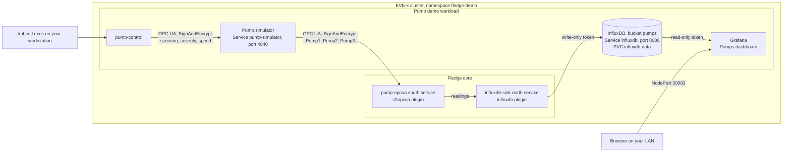

# Part 2: Pump data pipeline

This part adds a simulated fleet of three centrifugal pumps that Fledge reads
over a secure OPC UA connection. You can inject faults while it runs, such as
bearing wear, and see them in the readings. Each pump also publishes its current
fault as ground truth. Fledge forwards the readings to InfluxDB, a time-series
database, and a Grafana dashboard shows each pump's signals, its fault and the
age of its newest data. If InfluxDB is unavailable, Fledge keeps the readings and
sends them when InfluxDB is back.

Complete [part 1](1-install-fledge.md) first. The commands assume the terminal
settings from part 1 and the API port-forward on `127.0.0.1:8081`; to restore
them, see [Set up a terminal](terminal-setup.md).

## How it works



App Flows deploys the pump simulator, InfluxDB and Grafana from
`deploy/pump-demo`, as a second registration of your repository. Only Grafana is
reachable from your LAN. Fledge reads the pumps with the `pump-opcua` source,
over a connection that certificates from a demo certificate authority (CA)
secure, and sends the readings to InfluxDB with the `influxdb-sink` north
service. Fledge writes and Grafana reads with separate tokens. You control the
pumps with `pump-control`, which runs in the simulator pod. As in part 1, you
create the volume and Secrets yourself, so they stay when you remove the
workload. For details, see [architecture](architecture.md).

## Before you start

You need:

- Part 1, with Fledge ready.
- A default storage class for a second 2 GiB volume.
- `bash`, `openssl` and `jq` on your workstation.
- Capacity for the workload:

  | Part | Requests | Limits |
  | --- | --- | --- |
  | Pump simulator | 50m CPU, 96 MiB memory | 500m CPU, 256 MiB |
  | InfluxDB | 100m CPU, 256 MiB | 1 CPU, 1 GiB |
  | Grafana | 50m CPU, 192 MiB | 500m CPU, 1 GiB |

The workload uses the pinned published simulator image and the digest-pinned
`influxdb` 2.7 and `grafana/grafana` images set in the
[chart values](../deploy/pump-demo/chart/values.yaml). The pinned core image
includes the `s2opcua` source and `influxdb` north plugins. If you renamed the
namespace in part 1, see
[Use custom names](operations.md#use-custom-names-or-several-deployments) first.

## 1. Create the certificates

Choose a directory outside the repository for the certificates and keys. The
certificate script and every later command read it from `FLEDGE_CERT_DIR`:

```sh
export FLEDGE_CERT_DIR=~/.config/fledge-demo/opcua
scripts/make-opcua-certs.sh
```

The script creates the demo CA and the certificates it signs. It refuses a
directory inside the repository, so that no key can be committed, and it doesn't
overwrite existing files unless you pass `--force`.

Each `.der` file is a certificate and each `.pem` file is its private key:

| Name | Used by |
| --- | --- |
| `demo-ca` | Signs the other certificates. Keep `demo-ca.pem` on your workstation. |
| `demo-ca-crl.der` | The CA's revocation list. It is empty, but Fledge's OPC UA client requires one. |
| `pump-simulator` | The simulator's server certificate. |
| `fledge-opcua-client` | Fledge, uploaded in step 5. |
| `pump-operator` | `pump-control`. |

## 2. Create the volume and Secrets

Store the server and operator certificates in the namespace. The simulator
expects these exact file names:

```sh
kubectl -n fledge-demo create secret generic pump-simulator-server \
  --from-file="$FLEDGE_CERT_DIR/pump-simulator.der" \
  --from-file="$FLEDGE_CERT_DIR/pump-simulator.pem" \
  --from-file="$FLEDGE_CERT_DIR/demo-ca.der" \
  --from-file="$FLEDGE_CERT_DIR/demo-ca-crl.der"
kubectl -n fledge-demo create secret generic pump-simulator-operator \
  --from-file="$FLEDGE_CERT_DIR/pump-operator.der" \
  --from-file="$FLEDGE_CERT_DIR/pump-operator.pem"
```

[deploy/pump-demo-prerequisites.yaml](../deploy/pump-demo-prerequisites.yaml)
defines the `influxdb-data` PVC. Check for an existing one, then apply it:

```sh
kubectl get -f deploy/pump-demo-prerequisites.yaml --ignore-not-found
kubectl apply -f deploy/pump-demo-prerequisites.yaml
```

Create the InfluxDB and Grafana Secrets with generated passwords and an InfluxDB
admin token:

```sh
kubectl -n fledge-demo create secret generic influxdb-admin \
  --from-literal=username=admin \
  --from-literal=password="$(openssl rand -base64 18)" \
  --from-literal=token="$(openssl rand -hex 32)"
kubectl -n fledge-demo create secret generic grafana-admin \
  --from-literal=password="$(openssl rand -base64 18)"
```

InfluxDB uses `influxdb-admin` only on its first start, to create the admin user,
the `fledge-demo` organization and the `pumps` bucket. If you reinstall over a
retained `influxdb-data` volume, keep the existing Secret.

## 3. Deploy the pump demo

Register `deploy/pump-demo` as a second App Flows registration of your
repository. It uses the same SSH secret as the Fledge registration. Override the
registration name and path on each command. The commit must already be on GitHub:

```sh
FLEDGE_GITOPS_NAME=pump-demo FLEDGE_GITOPS_PATH=deploy/pump-demo \
  python3 scripts/app-flows.py apply --revision "$(git rev-parse HEAD)"
FLEDGE_GITOPS_NAME=pump-demo FLEDGE_GITOPS_PATH=deploy/pump-demo \
  python3 scripts/app-flows.py status
kubectl -n fledge-demo rollout status deployment/pump-simulator --timeout=180s
kubectl -n fledge-demo rollout status deployment/influxdb --timeout=300s
kubectl -n fledge-demo logs deployment/pump-simulator
```

The simulator becomes ready after it has loaded its certificates. The log then
shows a line that starts with
`serving opc.tcp://0.0.0.0:4840 (SignAndEncrypt, Basic256Sha256, anonymous)`.
InfluxDB becomes ready when it answers its health check. The Grafana pod stays in
`CreateContainerConfigError` until you create its token Secret in the next step.
This is expected.

## 4. Create the InfluxDB tokens

Create the two scoped tokens inside the InfluxDB pod, and store each one in a
Secret. The commands in the pod read the admin token from the pod's own
environment, so it doesn't reach your workstation:

```sh
influxdb_token_secret() {  # $1: write or read, $2: token description, $3: Secret name
  token=$(kubectl -n fledge-demo exec deployment/influxdb -- sh -c '
    export INFLUX_ORG="$DOCKER_INFLUXDB_INIT_ORG" INFLUX_TOKEN="$DOCKER_INFLUXDB_INIT_ADMIN_TOKEN"
    bucket=$(influx bucket list --name "$DOCKER_INFLUXDB_INIT_BUCKET" --hide-headers | cut -f1)
    influx auth create --'"$1"'-bucket "$bucket" --description "'"$2"'" --json' | jq -er .token) \
    || { echo "could not create the $2 token" >&2; return 1; }
  kubectl -n fledge-demo create secret generic "$3" --from-literal=token="$token"
}
influxdb_token_secret write fledge-write fledge-influxdb
influxdb_token_secret read grafana-read grafana-influxdb
kubectl -n fledge-demo rollout status deployment/grafana --timeout=300s
```

If a token can't be created, the function prints an error and creates no Secret.
`fledge-influxdb` holds the write token for the setup script; no pod uses it.
`grafana-influxdb` holds the read token for Grafana and for the storage check.

## 5. Configure Fledge

Apply the pump declaration:

```sh
python3 scripts/setup-fledge.py configure --api http://127.0.0.1:8081 \
  --config demos/pump.json --cert-dir "$FLEDGE_CERT_DIR"
```

`configure` checks that every certificate file exists before it changes anything.
It then uploads the CA, its revocation list, the simulator certificate and the
Fledge certificate and key to the Fledge certificate store, and creates or
updates the `pump-opcua` source. The output includes
`PASS: 4 declared certificates uploaded`. It never prints key material.

The declaration also disables the `gitops-sinusoid` source from part 1, so that
only pump data flows through the pipeline, and sets the retention to 6 hours.
Fledge keeps the sinusoid's settings and stored readings. To turn it back on,
apply `demos/sinusoid.json` again.

Then read the write token from its Secret and apply the InfluxDB declaration:

```sh
export FLEDGE_INFLUXDB_TOKEN="$(kubectl -n fledge-demo get secret fledge-influxdb -o jsonpath='{.data.token}' | base64 -d)"
python3 scripts/setup-fledge.py configure --api http://127.0.0.1:8081 --config demos/influxdb.json
```

The declaration contains `{"env": "FLEDGE_INFLUXDB_TOKEN"}` instead of the
token. `configure` refuses to change anything if the variable is unset or empty,
and it never prints the value. Running either command again is safe.

## 6. Check acquisition and storage

Check that readings arrive from all three pumps:

```sh
python3 scripts/verify-fledge.py --api http://127.0.0.1:8081 --config demos/pump.json
```

For each pump, the verifier looks for a recent step with all 13 values, and waits
up to 120 seconds for one. It ends with
`PASS: source pump-opcua running; Pump1, Pump2, Pump3 each have all 13 datapoints in one step within 10 s`.
In the GUI, **Readings** lists the assets `Pump1`, `Pump2` and `Pump3`.

To check InfluxDB, forward it to your workstation in another terminal:

```sh
kubectl -n fledge-demo port-forward --address 127.0.0.1 deployment/influxdb 8086:8086
```

Then run the storage check with the read token:

```sh
export FLEDGE_INFLUXDB_READ_TOKEN="$(kubectl -n fledge-demo get secret grafana-influxdb -o jsonpath='{.data.token}' | base64 -d)"
python3 scripts/verify-fledge.py --api http://127.0.0.1:8081 --config demos/influxdb.json
```

For each pump, the check looks for a point with all 13 fields that is less than
10 seconds old, and waits up to 120 seconds for one. It also checks that the
north service is running, and prints each pump's lag between Fledge and
InfluxDB. It ends with
`PASS: north service influxdb-sink running; Pump1, Pump2, Pump3 each have a point with all 13 fields in InfluxDB within 10 s`.
Use `--influxdb` if you forward to another address.

## 7. Open the dashboard

Grafana is on NodePort `30083` over plain HTTP, like the Fledge GUI; read the
[LAN warning](1-install-fledge.md#before-you-start). Open `http://<node-address>:30083` and
log in as `admin` with the password from the `grafana-admin` Secret:

```sh
kubectl -n fledge-demo get secret grafana-admin -o jsonpath='{.data.password}' | base64 -d; echo
```

Grafana opens the **Pumps** dashboard
([screenshot](images/dashboard.png)). Use **Pump** at the top to show some pumps
only. The dashboard shows:

- **Data age**: the time since each pump's newest point in InfluxDB. It turns
  orange after 10 seconds and red after 30.
- **Scenario (ground truth)**, **Severity (ground truth)** and **Scenario over
  time**: the fault that you set with `pump-control`.
- The measured signals, one panel per group, with one line per pump.
- **Condition monitoring**: each pump's anomaly score, once you complete
  [part 3](3-anomaly-scoring.md). Until then, the row shows no scores.

To keep Grafana off the LAN, see
[Browser and LAN access](browser-and-lan.md#grafana).

## 8. Inject and clear a fault

Show the pumps' controls and main values:

```sh
kubectl -n fledge-demo exec deployment/pump-simulator -- pump-control show
```

Set a fault scenario and its severity on one pump, from `0.0` (no effect) to
`1.0`:

```sh
kubectl -n fledge-demo exec deployment/pump-simulator -- \
  pump-control set Pump2 --scenario bearing-wear --severity 0.8
```

The tool prints the values that the pump reports after the change. The change
takes effect at the next one-second step; temperatures follow gradually. On the
dashboard, **Scenario (ground truth)** and **Severity (ground truth)** change
within a few seconds, and the affected signals follow. Clear the fault by setting
the scenario back:

```sh
kubectl -n fledge-demo exec deployment/pump-simulator -- \
  pump-control set Pump2 --scenario normal --severity 0
```

| Scenario | Effect with rising severity |
| --- | --- |
| `normal` | No fault. |
| `bearing-wear` | Higher bearing vibration and bearing temperature, at any load. |
| `cavitation` | Lower suction pressure, fluctuating flow and discharge pressure, and intermittent vibration peaks. |
| `impeller-wear` | Lower flow and discharge pressure at the same speed, and a lower motor current. |

`--setpoint` changes a pump's speed, from 0 to 1800 rpm; 0 stops the pump. The
default setpoints are 1450, 1200 and 1600 rpm for `Pump1`, `Pump2` and `Pump3`.
You can pass several options in one command. If a value is invalid, the tool
exits with an error and changes nothing. A restart of the simulator pod returns
every pump to normal operation at its default speed.

## Next

Continue with [Part 3: Anomaly scoring](3-anomaly-scoring.md). For the pump data
in detail, retention and what happens during an InfluxDB outage, see the
[reference](reference.md). To remove this part, see
[Remove the demo](remove.md).
