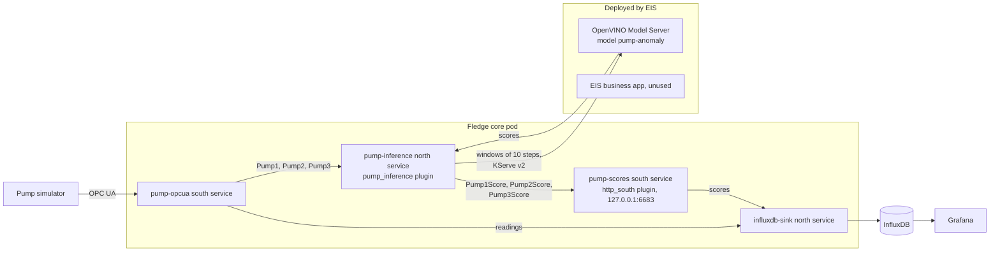

# Part 3: Anomaly scoring

This part scores each pump's condition with an anomaly model that ZEDEDA Edge
Inference Services (EIS) serves on the node's CPU. Fledge sends each pump's
readings to the model and stores every result as a reading of its own. The
**Condition monitoring** row of the Grafana dashboard shows the score next to the
fault that you injected.

Complete [part 2](2-pump-pipeline.md) first. The commands assume the terminal
settings from part 2, including `FLEDGE_INFLUXDB_TOKEN`, and the API port-forward
on `127.0.0.1:8081`; to restore them, see [Set up a terminal](terminal-setup.md).

## How it works



The model compares a pump's flow, pressures, motor current, power and vibration
with those of a healthy pump at the same speed, over windows of 10 one-second steps, and returns one anomaly score
per window. A score of 1.0 or more is anomalous. A script in this repository
trains it on the simulator's own pump model. EIS serves it with OpenVINO Model
Server through a KServe v2 endpoint inside the cluster. EIS owns this
deployment, not App Flows. It also deploys its standard business app, which runs
unused because Fledge is this demo's application.

In Fledge, the `pump-inference` north service sends the pump readings to the
endpoint, and posts each score back to the `pump-scores` south service as a
reading of its own asset, such as `Pump1Score`. The existing `influxdb-sink`
forwards the scores to InfluxDB with the other readings. Scoring never blocks
acquisition: while the endpoint is unavailable, Fledge keeps the unscored
readings and scores them later. [demos/inference.json](../demos/inference.json)
declares both services. For details, see [architecture](architecture.md).

## Before you start

You need:

- Part 2, with the pump and InfluxDB checks from its step 6 passing.
- Python 3.10 to 3.12 on your workstation, to create the model. Its pinned NumPy
  version has no builds for newer Python versions.
- An EIS organization with an existing upload provider that you can write to, and
  permission to write models. A second authorized EIS user must approve the
  deployment, and later its deletion: EIS doesn't let you approve your own.
- Capacity for the deployment that EIS generates. Its engine requests about 1 CPU
  and 2 GiB of memory, and its business app about 500m CPU and 1 GiB. Check the
  generated configuration before it is approved.
- NodePort 30080 free on the node. The EIS business app uses it.

The pinned core image includes the `pump_inference` and `http_south` plugins.
EIS uses its own credentials, separate from your ZEDEDA infrastructure
credentials. Keep its token out of files, chat and Git.

## 1. Create the model

Create a Python environment with the generator's pinned dependencies, then create
the model in a directory outside the repository:

```sh
python3 -m venv ~/.cache/fledge-demo/model-venv
~/.cache/fledge-demo/model-venv/bin/pip install -r model/pump-anomaly/requirements.txt
~/.cache/fledge-demo/model-venv/bin/python model/pump-anomaly/generate_model.py \
  ~/.cache/fledge-demo/pump-anomaly
```

The generator writes the directory that you upload in step 2, and one file next
to it:

- `pump-anomaly/model.onnx`, the model.
- `pump-anomaly/README.md`, the model card that EIS shows with the model. It
  describes the score, the input and output, the training and the limits, with
  the evaluation results and the model's SHA256.
- `pump-anomaly.reference.json`, three test windows and the scores the model
  must return for them. You use it to check the deployed model in step 3.

It prints the model's SHA256, its input and output, and its scores on simulated
operation that it didn't train on. It fails, and writes nothing, if the model
file doesn't compute the same scores as the generator, or if the model misses
its [evaluation thresholds](reference.md#anomaly-model).

## 2. Upload and deploy the model

1. In the terminal you use for the upload, set the EIS settings. Read the token
   without showing it:

   ```sh
   export EDGEAI_SERVICE_URL=https://YOUR_EIS_HOST
   read -rs EDGEAI_ACCESS_TOKEN && export EDGEAI_ACCESS_TOKEN
   export EDGEAI_CURRENT_ORG=YOUR_ORGANIZATION
   ```

2. Install the EIS SDK and upload the model directory as `pump-anomaly`.
   Replace the provider ID. The SDK's own output is suppressed, so that it can't
   print server details; the command prints only the import job:

   ```sh
   ~/.cache/fledge-demo/model-venv/bin/pip install zededa-eip-client==3.2.0
   ~/.cache/fledge-demo/model-venv/bin/python - <<'PY'
   import contextlib, io, json, os
   from zededa_eip_client.client import ZededaEIPClient
   try:
       with contextlib.redirect_stdout(io.StringIO()), contextlib.redirect_stderr(io.StringIO()):
           job = ZededaEIPClient().upload_model_from_local_files(
               model_name="pump-anomaly",
               file_paths=os.path.expanduser("~/.cache/fledge-demo/pump-anomaly"),
               provider_id="YOUR_PROVIDER_ID", organization_id=os.environ["EDGEAI_CURRENT_ORG"], wait=False,
               import_config={"description": "Anomaly score for the Fledge pump demo"})
   except Exception:
       raise SystemExit("Upload failed; check the import status in EIS before you retry.") from None
   print(json.dumps({key: job[key] for key in ("job_id", "id", "status") if key in job}))
   PY
   ```

   If the upload reports `models:write permission required`, your EIS user
   needs that permission; signing in again isn't enough. If it returns no job,
   check the import status in EIS before you retry.

3. Optional: give the model its picture in the catalog. In EIS, under
   **Models**, open `pump-anomaly`, hold the pointer over its image, select
   **Upload** and choose [model/pump-anomaly/thumbnail.png](../model/pump-anomaly/thumbnail.png).
   Later uploads keep it.
4. In EIS, under **Models**, wait until `pump-anomaly` has a new version, and
   note its number: 1 for the first upload. Open the model and select
   **Deploy**:
   - **Basic Info**: enter a **Name** for the deployment.
   - **Model Configuration**: select that **Version**. Keep the default
     **Business App Image**; the demo doesn't use it.
   - **Target Configuration**: select **Single Cluster** as **Target Type**,
     your cluster as **Target Cluster** and AMD64 as **Architecture**. EIS
     fills in **Project Name**.
   - **Review**: check the settings and select **Deploy**.
5. Ask the second user to open **Deployments → Pending Reviews**, review the
   generated configuration and approve it. Before approving, check the ports,
   the images, the resource requests and limits, and that the model loads from
   your provider.

The first deployment can take several minutes while the node downloads the
images and the model.

[demos/inference.json](../demos/inference.json) expects `pump-anomaly` version 1.
EIS never reuses a version number, so each upload of the same name gets the next
one. If your version or name differ, use them in the check in step 3, and set
`version` and `model` in the declaration to match before step 4.

## 3. Check the deployed model

Find the engine. EIS chooses its namespace and names. Its pod carries the label
`app.kubernetes.io/component=openvino-server`:

```sh
kubectl get pods -A -l app.kubernetes.io/component=openvino-server
kubectl -n <namespace> get services
```

Wait until the pod is ready, then forward the engine Service's REST port, 8001,
to your workstation in another terminal:

```sh
kubectl -n <namespace> port-forward --address 127.0.0.1 service/<engine-service> 18001:8001
```

Run the check with the reference file from step 1:

```sh
python3 model/pump-anomaly/check_engine.py --endpoint http://127.0.0.1:18001 \
  --model pump-anomaly --version 1 \
  --reference ~/.cache/fledge-demo/pump-anomaly.reference.json
```

The check sends the three test windows in one request. It passes, and prints the
three scores, when the endpoint answers for the same model and version with the
expected output and every score matches the reference. Otherwise it fails with
the reason, for example `engine rejected the request: HTTP 404` for a model or
version that the engine doesn't serve. Stop the port-forward when it passes.

Do not print the generated Helm values or the full pod arguments: they can
contain the credentials of your model store.

## 4. Configure scoring

Set the engine's address inside the cluster, with the Service and namespace from
step 3, and apply the inference declaration:

```sh
export FLEDGE_INFERENCE_URL=http://<engine-service>.<namespace>.svc:8001
python3 scripts/setup-fledge.py configure --api http://127.0.0.1:8081 --config demos/inference.json
```

`configure` creates the `pump-scores` south service first, then the
`pump-inference` north service, and enables both. It refuses to change anything
if `FLEDGE_INFERENCE_URL` is unset or empty. Running it again is safe. Fledge
also scores the readings it acquired before this step, as far back as its
retention reaches.

The Service name contains part of the deployment's ID, so a new deployment gets a
new name; see [Deploy the model again](operations.md#deploy-the-model-again).

## 5. Check the scores

```sh
python3 scripts/verify-fledge.py --api http://127.0.0.1:8081 --config demos/inference.json
```

The check passes when both services are enabled and running, and every running
pump has a score that is less than 30 seconds old. It waits up to 120 seconds for
one. A stopped pump gets no scores, so the check reports it as stopped instead of
failing. For each running pump, it prints the score's age and its lag behind the
pump's readings, and it ends with
`PASS: services pump-inference, pump-scores running; every running pump has a score within 30 s`.

In the Fledge GUI, **Readings** now also lists `Pump1Score`, `Pump2Score` and
`Pump3Score`.

## 6. See a fault in the score

On the Grafana dashboard, the **Condition monitoring** row shows:

- **Score age**: the time since each pump's newest score. It turns orange after 10
  seconds and red after 30. A stopped pump gets no scores, so its age keeps
  growing.
- **Anomaly score and severity**: each pump's score as a solid line on the left
  axis, with the anomalous range from 1.0 shaded red, and the injected severity
  as a dashed line on the right axis. The line shows the highest score in each
  display interval.
- **Scenario (ground truth)**: the fault that you set, on the same time axis.

Inject a fault as in step 8 of part 2:

```sh
kubectl -n fledge-demo exec deployment/pump-simulator -- \
  pump-control set Pump2 --scenario bearing-wear --severity 0.8
```

About 10 seconds later, `Pump2`'s score rises above 1.0, while the other pumps
stay below it, as in the [README's screenshot](../README.md). After a minute, check it:

```sh
python3 scripts/verify-fledge.py --api http://127.0.0.1:8081 --config demos/inference.json \
  --expect-anomalous Pump2
```

With `--expect-anomalous`, the check also requires `Pump2`'s median score over the
last 60 seconds to be at least 1.0, and every other running pump's median to be
below 1.0. A single high score on a healthy pump doesn't fail it. Clear the fault
with `pump-control set Pump2 --scenario normal --severity 0`; the score falls
below 1.0 within about 10 seconds.

## What the score means

- **It shows that a pump departs from normal behavior**, not which fault it has.
  Compare it with the ground truth to see what you injected.
- **It is as illustrative as the simulator.** The model was trained on the
  simulator's own physics, so the demo shows the path from readings to
  inference, not a model that would detect faults in a real pump.
- **Weak faults and slow pumps are harder to detect.** At severity 0.25, a fault
  can score below 1.0. Impeller wear lowers flow in proportion to speed, so below
  300 rpm even severe impeller wear may stay below 1.0.
- **A pump needs 10 running steps for a score.** After a pump starts, after a gap
  in its readings longer than 1.5 seconds, and after the Fledge pod restarts,
  its first score comes 10 seconds later. A change to the `pump-inference`
  settings, for example with `configure`, starts the windows again too, so up
  to about 20 seconds of steps around the change get no score. A stopped pump
  gets no score; while it slows down to a standstill, it still counts as
  running.

## Next

For what happens during an engine outage, see the
[reference](reference.md#outages). To remove this part, see
[Remove the demo](remove.md#remove-anomaly-scoring).
